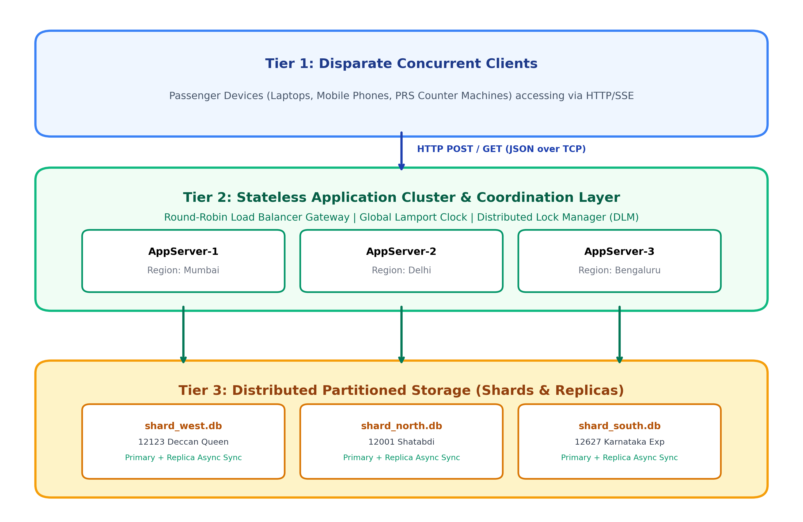
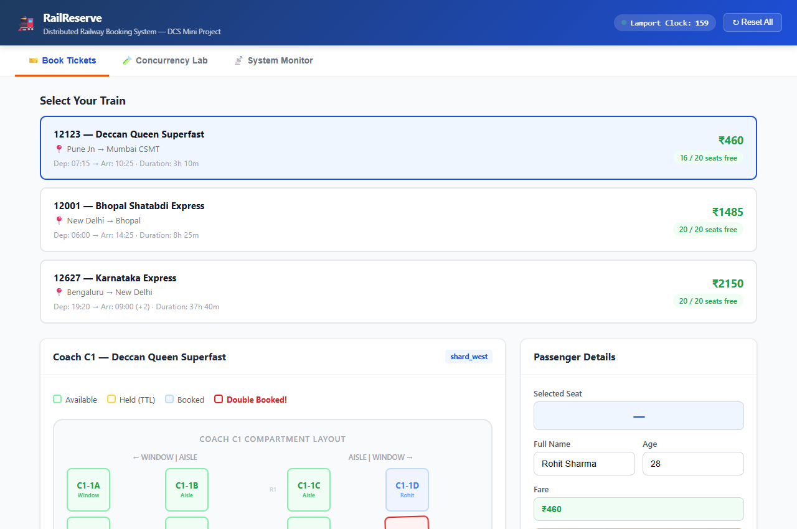
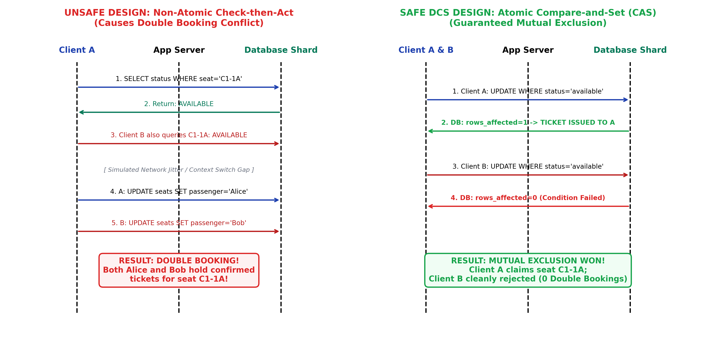
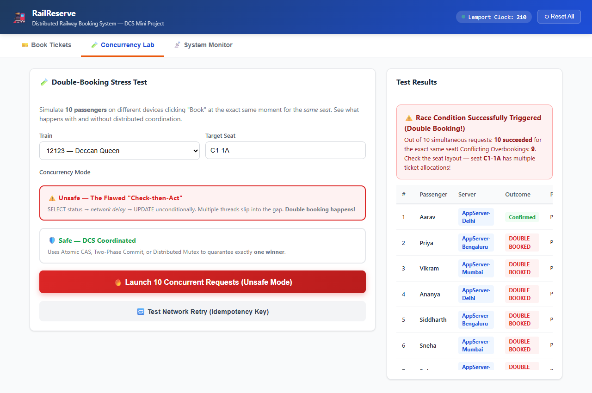
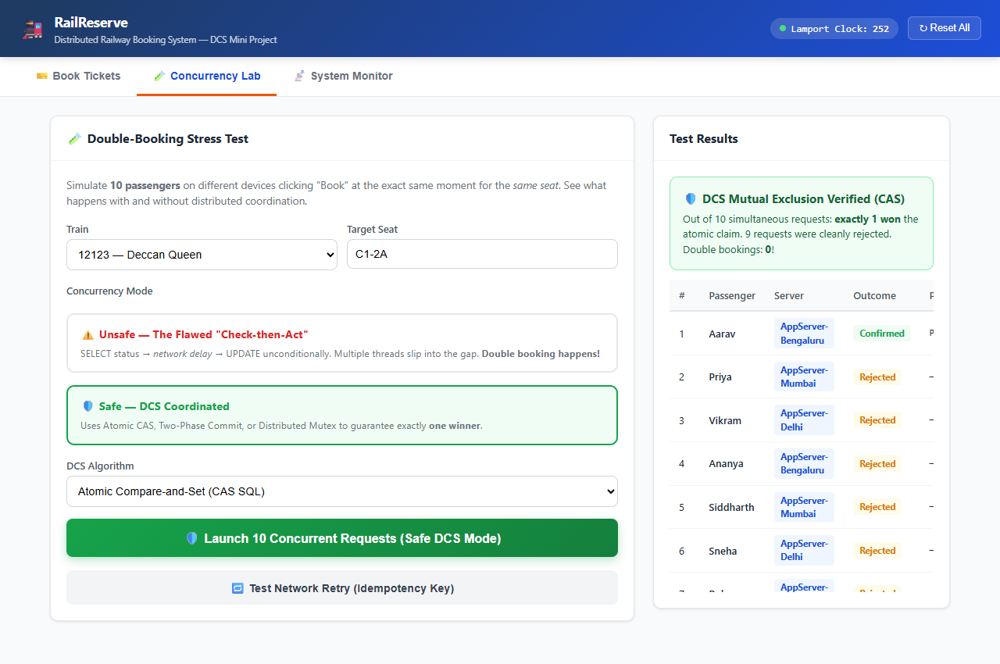
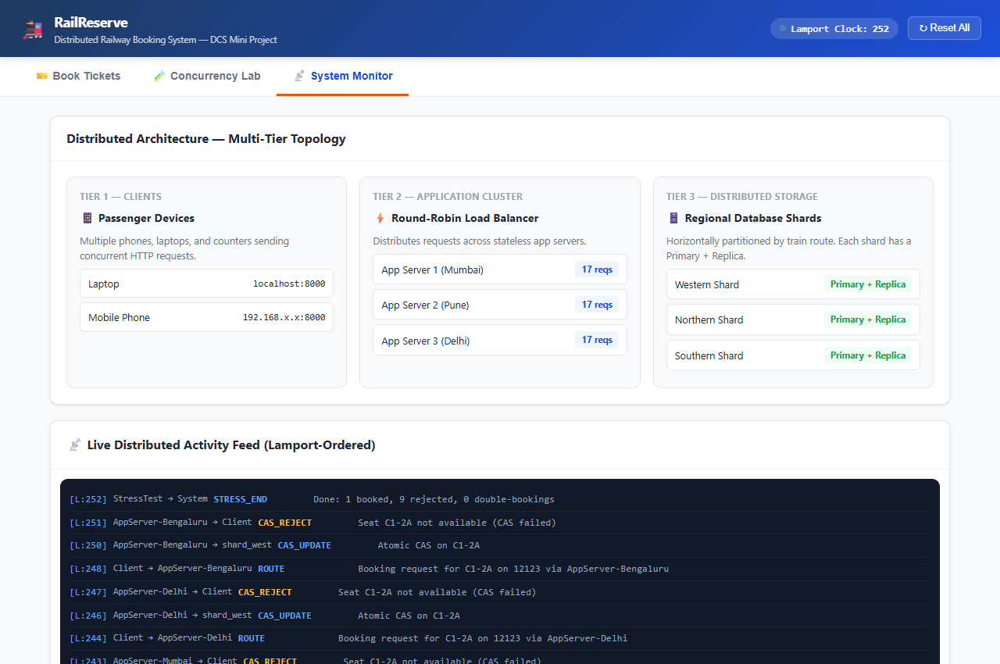

# 🚆 RailReserve DCS: Distributed Railway Reservation System

<div align="center">


<p align="center">
  <b>A real-time distributed computing simulation demonstrating race conditions, Atomic CAS, Two-Phase Commit (2PC), Lamport Logical Clocks, and horizontal database sharding under Tatkal-scale concurrency surges.</b>
</p>

</div>

---

## 🏛️ Academic Context
- **Course:** Distributed Computing Systems (DCS)
- **Institution:** Pimpri Chinchwad College of Engineering (PCCOE), Pune
- **Department:** Department of Information Technology | Academic Year 2026-27
- **Contributors:**
  - **Sankarshan Mahamuni** (PRN: 123B1F057)
  - **Machindra Mane** (PRN: 123B1F060)
  - **Yash Mulik** (PRN: 123B1F064)

---

## 📸 System Showcase

<div align="center">
  
  <p><i>Figure 1: Complete Three-Tier Distributed Architecture with Sharded SQLite Engines and Replication</i></p>
</div>

<br/>

<div align="center">
  
  <p><i>Figure 2: Real-time Interactive Booking Dashboard & Coach Seat Layout</i></p>
</div>

---

## 🌟 Project Overview

**RailReserve DCS** is an interactive, full-stack Distributed Systems Simulation Platform designed to model, reproduce, and resolve high-concurrency race conditions (such as the classic **Double Booking Anomaly** in IRCTC Tatkal surges).

The platform simulates a distributed cloud environment on a local or multi-device testbed:
1. **Tier 1 (Clients):** Multi-device web clients (desktop browsers, smartphones, tablets) accessing the platform concurrently with real-time **Server-Sent Events (SSE)** synchronization.
2. **Tier 2 (Stateless Application Cluster):** Round-Robin Load Balancer dispatching incoming requests across 3 simulated application servers (*Mumbai, Delhi, Bengaluru*) with **Lamport Logical Clock** event ordering and **Distributed Lock Management (DLM)**.
3. **Tier 3 (Distributed Partitioned Storage):** Horizontally partitioned regional database shards (*Western, Northern, Southern*) with asynchronous primary-to-replica log shipping.

---

## 🔬 Core Distributed Concepts & Concurrency Lab

<div align="center">
  
  <p><i>Figure 3: Sequence Flow Comparison — Non-Atomic Check-then-Act vs. Atomic Compare-And-Set (CAS)</i></p>
</div>

### 1. Unsafe vs. Safe Concurrency Modes
The platform includes an interactive Concurrency Lab allowing users to fire concurrent booking requests against the same seat under different concurrency algorithms:

| Concurrency Strategy | Mechanism | Result |
| :--- | :--- | :--- |
| **Unsafe (Check-then-Act)** | Reads seat status, artificially sleeps, then updates. | ❌ **Double Booking Conflict!** Multiple passengers assigned the same seat. |
| **Safe Atomic (CAS)** | `UPDATE seats SET status='booked' WHERE id=? AND status='available'` | ✅ **Strict Consistency.** Exactly one transaction wins atomically; the other receives 409 Conflict. |
| **Distributed Mutex (DLM)** | Centralized lease coordinator with automatic 15-second TTL lease expiry. | ✅ **Mutual Exclusion.** Subsequent requests block or fail gracefully until release. |

<div align="center">
  
  
  <p><i>Figure 4: Side-by-side verification — Unsafe Double Booking Anomaly vs. Atomic CAS Guarantee</i></p>
</div>

### 2. Two-Phase Commit (2PC) Distributed Consensus
Coordinates distributed operations across heterogeneous microservices (e.g., Seat Reservation service + Bank Payment service):
- **Phase 1 (Prepare):** Coordinator queries all participants: *Can you commit?* Participants acquire local locks, log undo/redo records, and vote `VOTE_COMMIT` or `VOTE_ABORT`.
- **Phase 2 (Commit/Abort):** If all participants voted yes, Coordinator broadcasts `GLOBAL_COMMIT`; if any participant failed or timed out, Coordinator issues `GLOBAL_ABORT` with rollback.

### 3. Lamport Logical Clocks
Implements Leslie Lamport’s logical timestamp synchronization algorithm:
$$C(e) = \max(C_{local}, C_{received}) + 1$$
Ensures total causal event ordering ($a \rightarrow b \implies C(a) < C(b)$) across all simulated regional nodes without relying on synchronized physical clocks.

### 4. Idempotency Keys
Enforces network fault tolerance via unique client-generated UUID idempotency headers (`X-Idempotency-Key`). Network retries and duplicate packet transmissions are safely deduplicated, preventing double debits.

---

## 🖥️ System Topology & Live Monitor

<div align="center">
  
  <p><i>Figure 5: Live Distributed Topology Monitor showing Regional Shard Health & Replica Sync</i></p>
</div>

---

## 📂 Project Structure

```
railway-concurrency-dcs/
├── data/                                 # Horizontally Sharded Databases
│   ├── shard_north.db / replica.db       # Northern Railway Shard
│   ├── shard_south.db / replica.db       # Southern Railway Shard
│   └── shard_west.db / replica.db        # Western Railway Shard
├── docs/                                 # Academic Documentation
│   ├── DCS_Mini_Project_Report_*.docx    # Complete Project Academic Report
│   ├── diagrams/                         # High-res architectural diagrams
│   └── screenshots/                      # Real execution figures & test outputs
├── static/                               # Client Application (Tier 1)
│   ├── index.html                        # Multi-screen booking & lab UI
│   ├── style.css                         # Custom responsive theme
│   └── app.js                            # SSE client, SSE graph, & lab controls
├── .gitignore
├── LICENSE                               # MIT License
├── README.md                             # Repository Documentation
├── requirements.txt                      # Python dependencies
├── run_app.bat                           # 1-Click Windows execution launcher
└── server.py                             # FastAPI DCS Core (Tier 2 & 3 Coordinator)
```

---

## ⚡ Quick Start Guide

### 1. Prerequisites
- Python 3.10 or later

### 2. Installation
```bash
git clone https://github.com/Sankarshan-Mahamuni/railway-concurrency-dcs.git
cd railway-concurrency-dcs
pip install -r requirements.txt
```

### 3. Start the Server
Run with Uvicorn (or double-click `run_app.bat` on Windows):
```bash
python -m uvicorn server:app --host 0.0.0.0 --port 8000 --reload
```

### 4. Access the Platform
- **Local Machine:** [http://localhost:8000](http://localhost:8000)
- **Multi-Device Testing (Same Wi-Fi Network):** `http://<YOUR_LAN_IP>:8000` (e.g. `http://192.168.1.15:8000`)

---

## 📄 License
This project is licensed under the MIT License - see the [LICENSE](LICENSE) file for details.
